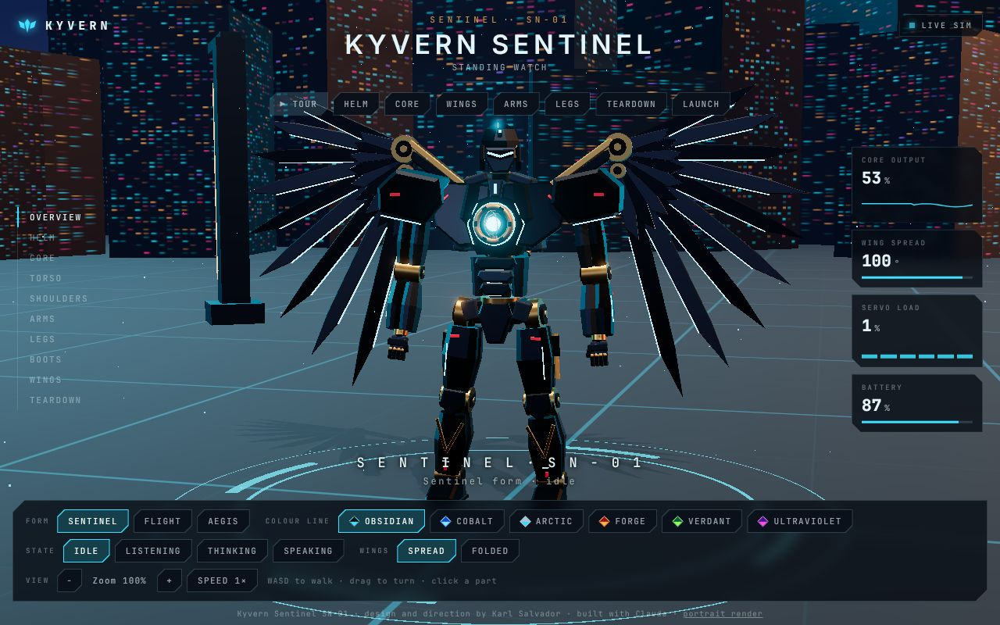

# Kyvern Sentinel

A working 3D model of the Sentinel (SN-01), the winged robot form of Kyvern, Karl Salvador's local AI companion.

Live: https://kyvern.sentinel.arklonlabs.com



## What you can do on the page

- **Click a part** and it comes apart to show the pieces it is made of. The camera does not move when you click.
- **Sections** on the left open one group of parts (helm, core, torso, shoulders, arms, legs, boots, wings). **Teardown** takes every part apart; click it again for every piece.
- **Form**: Sentinel (standing), Flight, Aegis (wings closed in front as a shield). He lets go of his parts and locks them back as he changes.
- **Wings**: Spread or Folded. Folded tucks them away behind his back. Spreading is staged: the arm swings up, then the blades slide out and fan open from the top.
- **Colour line**: Obsidian is the locked design. Changing line sweeps the new paint across him.
- **State**: Idle, Listening, Thinking, Speaking. The core and the body show what Kyvern is doing.
- **Walk**: W A S D or the arrow keys (a touch pad shows on phones). In Flight form the same keys fly him.
- **Tour**: the chips under the title play short chapters. Drag to turn, scroll to zoom, double-click to reset.

## Run it

No build step. Serve the folder and open it:

```
npm start        # python3 -m http.server 8080, then open http://localhost:8080
npm test         # checks the parts tree, teardown, forms, wings and tour
```

It has to be served (not opened as a file) because it uses JavaScript modules. three.js is included in `vendor/`, so it works offline.

Address options: `?line=cobalt`, `?form=flight`, `?state=thinking`, `?wings=folded`, `?hud=0` (robot only, for the side screen), `?quality=1|2|3`.

## Driving him from Kyvern

The page exposes `window.sentinel`:

```js
sentinel.setState('thinking')   // idle | listening | thinking | speaking
sentinel.setWings(false)        // fold; true spreads
sentinel.setForm('flight')      // sentinel | flight | aegis
sentinel.setLine('cobalt')
sentinel.open('legs')           // a section, 'teardown' or 'overview'
sentinel.openPart('thigh_l')
sentinel.powerUp()
```

From another frame: `frame.contentWindow.postMessage({ sentinel: ['setState', 'speaking'] }, '*')`.

## How it is put together

See [docs/FRAMEWORK.md](docs/FRAMEWORK.md). In short: `src/framework/` is a small robot framework that knows nothing about the Sentinel, and `src/sentinel/` is the Sentinel built on it (26 parts split joint by joint, each made of named pieces).

The earlier living render is kept at [`/portrait/`](portrait/).

## Credits

Design and direction: Karl Salvador. Built with Claude. The page layout follows Karl's Bitsy BT-8; all code and the model here are written for the Sentinel. 3D rendering: [three.js](https://threejs.org) (MIT, in `vendor/three`).
